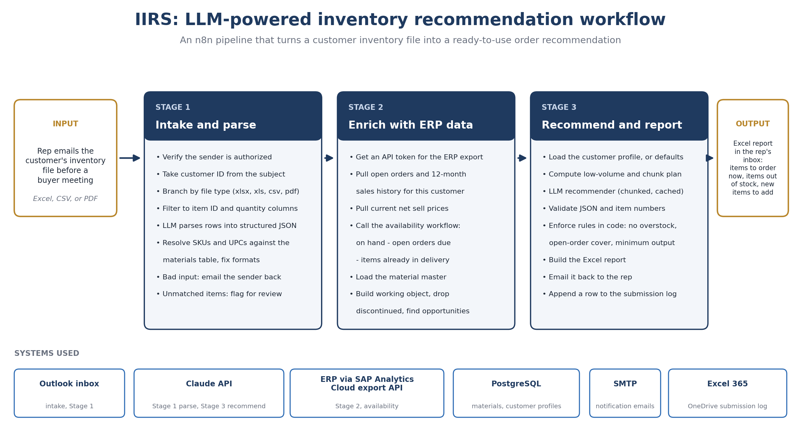

# IIRS: LLM-Powered Inventory Recommendation Workflow

An n8n-based system that turns a customer's inventory file into a ready-to-use order recommendation. Outside sales reps email in a customer's inventory report before a buyer meeting. A few minutes later they get back an Excel report showing stock gaps and what to recommend.

This repository is a **sanitized, generic version** of a system I designed, built, and run in production for a manufacturer. It uses mock data and placeholder credentials. No company data, customer data, or business rules are included.

> **In production:** used weekly by 37 outside sales reps.

---

## The problem

Sales reps meet buyers who carry a mix of the manufacturer's products. Before this system, finding out what a customer was short on meant manually comparing the customer's stock report against current availability, open orders, and what the company could actually ship. That was slow, inconsistent, and often skipped.

## What it does

1. **Intake.** A rep emails a customer inventory file (Excel, CSV, or PDF) to a monitored inbox. The customer ID comes from the email subject line.
2. **Parse.** The workflow detects the file type, strips the noise down to the two fields that matter (item identifier and quantity on hand), and sends them to an LLM to normalize into clean structured data.
3. **Enrich.** It pulls current data from the ERP: stock, open orders, items already in delivery, sales history, and the product catalog.
4. **Recommend.** An LLM applies the recommendation rules to the combined data and produces a ranked list: items to order now, items available later, and new items the customer doesn't carry yet.
5. **Report.** The result is built into an Excel workbook and emailed back to the rep.

## Architecture

```
Email inbox
   |
   v
[Stage 1: Intake and parse]
   file-type branches (xlsx / xls / csv / pdf)
   column filtering -> LLM parse -> validate
   |
   v
[Stage 2: Enrich]
   ERP data (stock, open orders, in-delivery, sales history, catalog)
   customer profile lookup (PostgreSQL)
   build working object
   |
   v
[Stage 3: Recommend and report]
   LLM recommender (chunked) -> parse and validate response
   enforce rules and minimum-output floor in code
   Excel report -> email back to rep
   submission log (Excel 365 on OneDrive)
```



## Stack

| Layer | Tools |
|---|---|
| Orchestration | n8n (self-hosted), with sub-workflows per stage |
| LLM | Anthropic Claude API |
| Languages | JavaScript (n8n code nodes), SQL |
| Data | PostgreSQL for customer profiles; ERP data through an export API |
| Output | ExcelJS for report generation; SMTP for delivery |
| Logging | Excel 365 on OneDrive |

In production, ERP data comes from SAP S/4HANA through SAP Analytics Cloud's data export API. In this repo, a mock product and stock table stands in for it.

## Design decisions

- **Rules enforced in code, not just in the prompt.** The prompt tells the model what to do, but the workflow also checks the result: overstocked items are excluded, items already covered by open orders are excluded, and a minimum number of recommendations is guaranteed. An LLM can drift, so the checks don't depend on it following instructions.
- **Parse data in code where possible.** Fields that can be derived deterministically are derived in code. The model is only asked to do the part that needs language understanding.
- **Chunked requests.** Large accounts are split into chunks so responses don't hit output limits, then recombined.
- **Human-readable output.** Reps are not technical. The deliverable is a formatted Excel report they can open on the way into a meeting.
- **Prompt caching** to cut cost and latency on repeated system-prompt content.

## Handling AI risk

- **Validation.** Responses are parsed and validated before anything reaches a user. Malformed output is caught instead of passed through.
- **Bad inputs.** Missing customer IDs and unreadable files trigger a notification email back to the sender instead of failing silently.
- **Unknown data.** Items the system can't match are flagged for review, not guessed at.
- **Scope.** The model recommends. It doesn't place orders. A person decides.

## Rollout

- Ran user acceptance testing with outside sales rep agencies before launch.
- Delayed go-live to fix an inventory-availability calculation error and to handle special-make-up items that should not be broadly recommended.
- Wrote the user guide and rollout communications.

## Lessons from production

- **Sub-workflow versioning.** A calling workflow kept executing an older published version of a sub-workflow. Root cause: the published version still held a deprecated model string. The fix was republishing cleanly and checking the version in use.
- **Output truncation.** Long responses were cut off mid-JSON. Fixed by chunking requests and raising the token limit.
- **Parsing model output.** When a response contained more than one JSON block, the parser took the wrong one. It now takes the last block.
- **Empty results are unacceptable.** Early versions occasionally returned nothing for low-volume accounts. A minimum-output rule and a code-level floor fixed it.

## Built with AI-assisted development

I design the architecture and business logic, specify what each node should do, review and test the generated JavaScript and SQL against real data, debug failures, and deploy. I use an LLM to write much of the code. The decisions about what to build, how the pieces fit together, and whether the output is correct are mine.

## Repository contents

```
workflows/
  01-intake-and-parse.json          Stage 1: email intake, file parsing, LLM parse, SKU resolution
  02-enrich-with-erp-data.json      Stage 2: pulls ERP data and builds the working object
  03-recommend-and-report.json      Stage 3: LLM recommender, validation, floors
  04-availability-calculation.json  Available-to-sell calculation, called by Stage 2
db/
  01_schema.sql                     Mock tables: materials, customer profiles
  02_seed.sql                       Fabricated seed data
sample-data/
  sample-inventory.csv              Messy customer file (junk header rows, bad SKUs, totals row)
  mock-erp-data.csv                 Stand-in for the ERP data the workflows pull
  sample-recommendation-report.xlsx Example output with live formulas
docs/
  architecture.png                  Architecture diagram
```

All names, SKUs, prices, and quantities are fabricated. The workflow files are sanitized exports: credentials, tenant URLs, provider IDs, and workflow IDs are placeholders you need to replace.

## Running it yourself

1. Create a PostgreSQL database and run `db/01_schema.sql`, then `db/02_seed.sql`.
2. Import the four workflow files into n8n. Stage 1 calls Stage 2 and Stage 3, and Stage 2 calls the availability workflow, so update the workflow IDs in the Execute Workflow nodes after import.
3. Create credentials for the LLM API (header auth), SMTP, PostgreSQL, Outlook, and Excel, and attach them where the nodes show `REPLACE_ME`.
4. In production the ERP data comes from SAP Analytics Cloud. Without SAP, replace the SAC HTTP request nodes in Stage 2, Stage 3, and the availability workflow with a node that reads `sample-data/mock-erp-data.csv`, and keep the output field names the same.
5. Email `sample-data/sample-inventory.csv` to the monitored inbox with a subject that contains the 7-digit customer ID `1000002` (for example, "Inventory 1000002"). Customer `1000002` has no profile, so the defaults apply: 9 weeks of cover.
6. Compare the report you get back with `sample-data/sample-recommendation-report.xlsx`.

Not every path is exercised by the sample, and I have not run the sanitized files end to end against the mock data. Treat them as a reference implementation.

## About me

Deon Martin. I build AI and automation systems on top of SAP and Microsoft 365, and I manage a company's S&OP process in SAP IBP.
[LinkedIn link]
